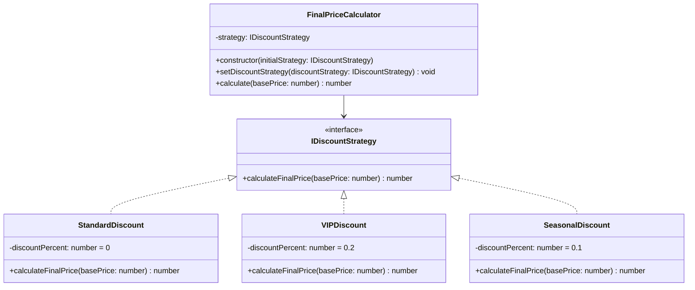

# Strategy Pattern - Final Price Calculator

## Problem Overview

In an e-commerce checkout flow, applying different discount rules (e.g., Standard 0%, VIP 20%, Seasonal 10%) inside a single calculator class using `if/else` or `switch` statements leads to tightly coupled code. Adding a new discount strategy requires modifying existing tested code, which directly violates the Open/Closed Principle.

## Architecture & Solution

The Strategy Pattern delegates the execution of pricing calculations to isolated strategy classes that implement a shared `IDiscountStrategy` interface.

Validation for invalid input (`basePrice < 0`) is handled globally inside `FinalPriceCalculator` to prevent logic duplication across individual strategy implementations.

